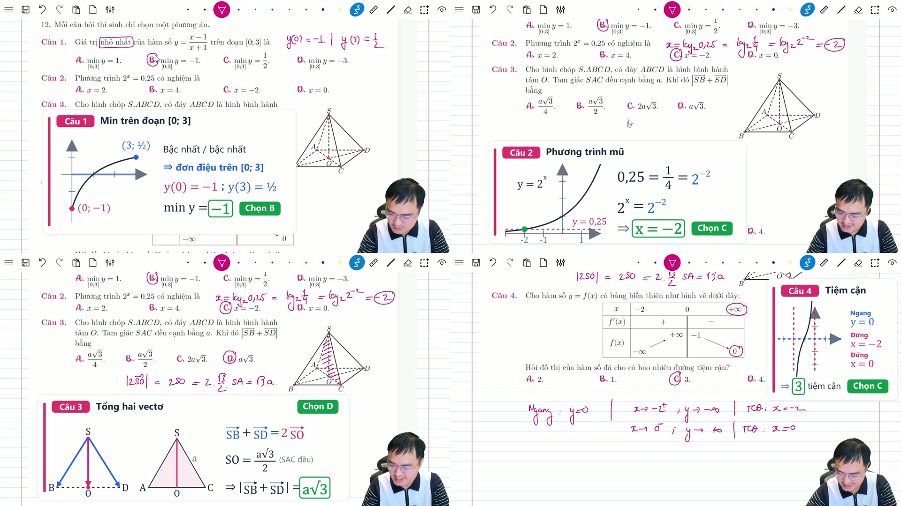
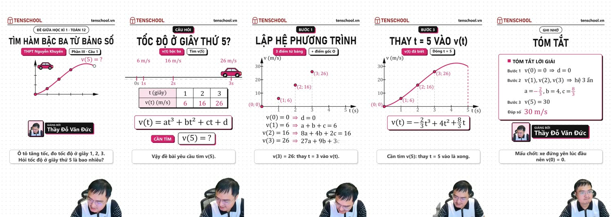

# Skills edit video bài giảng toán

3 skill Claude Code cho video chữa đề toán (quay màn hình bảng + webcam giáo viên), làm hoàn toàn bằng code: ffmpeg, faster-whisper, Manim, u2net, Pillow. Không dùng API trả phí.

| Skill | Đầu vào | Đầu ra |
|---|---|---|
| [`edit-bai-giang-dai`](skills/edit-bai-giang-dai/SKILL.md) | Video ngang nhiều câu | Video ngang, giữ màn hình thầy live, thêm card bài giải trắng vào vùng bảng trống |
| [`edit-bai-giang-short`](skills/edit-bai-giang-short/SKILL.md) | 1 câu trong video ngang | Video dọc 1080x1920 kiểu TikTok, dựng lại đề + lời giải, thầy tách nền góc dưới |
| [`thumbnail-bai-giang`](skills/thumbnail-bai-giang/SKILL.md) | PDF đề / bài giảng + ảnh thầy | Thumbnail 1280x720 style kênh thầy Đức + description YouTube |

## edit-bai-giang-dai



Card hiện từng bước theo lời thầy: hình, các dòng biến đổi, kết quả đóng khung xanh, chip "Chọn X". Vị trí card chọn bằng "ink map" (min từng pixel qua cả câu) để không che chữ thầy viết.

<p></p>

## edit-bai-giang-short



<p></p>

## thumbnail-bai-giang


Hình cắt thẳng từ PDF (`figs.py` quét ra toạ độ), nét đen đổi sang hồng. Mỗi tấm là 1 file JSON: tiêu đề, badge, màu thanh, 2 hình, ảnh thầy. Ảnh thầy và font Montserrat không có trong repo, xem SKILL.md.

## Cài

Copy thư mục skill vào `~/.claude/skills/`:

```bash
git clone https://github.com/thanhthuduc99/math-lesson-edit-skills
cp -r math-lesson-edit-skills/skills/* ~/.claude/skills/
```

Cần: `ffmpeg`, Python 3.11+, `manim` 0.22, `faster-whisper`, `opencv-python`, `onnxruntime`, `Pillow`, `pymupdf`. Font Windows: Segoe UI, Cambria Math, Bahnschrift.

Rồi nói với Claude Code: "edit video bài giảng dài này" "làm short bài giảng từ câu 1" hoặc "làm thumbnail chữa đề này".
