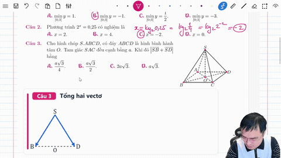
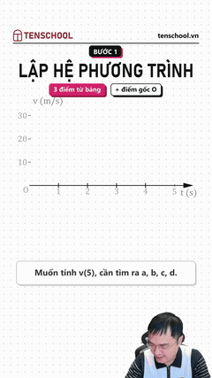

# Skills edit video bài giảng toán

Bộ skill Claude Code cho video chữa đề toán (quay màn hình bảng + webcam giáo viên): edit video dài, cắt short, viết title + description, làm thumbnail, và tuỳ chọn tự đăng YouTube. Làm hoàn toàn bằng code: ffmpeg, faster-whisper, Manim, u2net, Pillow. Không dùng API trả phí.

| Skill | Đầu vào | Đầu ra | Câu prompt nhắn cho AI |
|---|---|---|---|
| [`edit-bai-giang-dai`](skills/edit-bai-giang-dai/SKILL.md) | Video ngang nhiều câu | Video ngang, giữ màn hình thầy live, thêm card bài giải trắng vào vùng bảng trống | "Edit video bài giảng dài này: `video.mp4`, đáp án ở `de.pdf`." |
| [`edit-bai-giang-short`](skills/edit-bai-giang-short/SKILL.md): chọn câu | 1 hoặc vài câu trong video ngang | Mỗi câu 1 video dọc 1080x1920 kiểu TikTok, dựng lại đề + lời giải, thầy tách nền góc dưới | "Từ video dài vừa edit, làm short câu 3, Phần II câu 1 và Phần III câu 5." |
| [`edit-bai-giang-short`](skills/edit-bai-giang-short/SKILL.md): tất cả các câu | Cả video ngang | 1 short cho mỗi câu trong đề, render lần lượt từng cái | "Làm short tất cả các câu trong video `video.mp4`, đáp án ở `de.pdf`." |
| [`youtube-title-description`](skills/youtube-title-description/SKILL.md) | Video cuối + PDF đáp án | 3 title để chọn, description SEO, timestamp từng câu | "Viết title, description và timestamp cho video dài, link đề: `<link drive>`." |
| [`thumbnail-bai-giang`](skills/thumbnail-bai-giang/SKILL.md) | PDF đề / bài giảng | Thumbnail 1280x720 style kênh thầy Đức, ảnh thầy có sẵn | "Làm thumbnail video dài, tiêu đề \"ĐỀ GIỮA HK1 NGUYỄN KHUYẾN\", badge \"2026-2027\"." |
| [`auto-post-youtube`](skills/auto-post-youtube/SKILL.md) (tuỳ chọn) | Video + title + description + thumbnail | Video private trên kênh, cần setup OAuth riêng | "Đăng video dài lên YouTube với title số 1." |

## 1. Edit long: `edit-bai-giang-dai`


Card hiện từng bước theo lời thầy: hình, các dòng biến đổi, kết quả đóng khung xanh, chip "Chọn X". Vị trí card chọn bằng "ink map" (min từng pixel qua cả câu) để không che chữ thầy viết.

<p></p>

## 2. Edit short: `edit-bai-giang-short`


<p></p>

## 3. Title, description: `youtube-title-description`

Học từ kênh [@thayduc](https://www.youtube.com/@thayduc). Ra 3 title theo 3 kiểu kênh đã dùng (chuẩn SEO, móc câu phân loại, nhấn đáp án) và description đủ khối: đoạn mở có từ khoá, câu đáng xem, timestamp, đáp án nhanh, link tải đề, hashtag, tags.

Timestamp là phần quan trọng nhất. `chapters.py` đọc transcript, lấy lần đầu thầy nói "câu 1", "câu 2"... làm mốc, tự nhận ra lúc sang Phần II, Phần III. Claude điền nội dung từng câu từ PDF đề. Mẫu: [`description-nguyen-khuyen.txt`](skills/youtube-title-description/examples/description-nguyen-khuyen.txt).

## 4. Thumbnail: `thumbnail-bai-giang`


Hình cắt thẳng từ PDF (`figs.py` quét ra toạ độ), nét đen đổi sang hồng. Mỗi tấm là 1 file JSON: tiêu đề, badge, màu thanh, 2 hình, ảnh thầy. 3 ảnh thầy tách nền có sẵn trong `teacher/`, mỗi tấm xoay vòng 1 ảnh. Font Montserrat tải riêng, xem SKILL.md.

## 5. Auto-post: `auto-post-youtube` (tuỳ chọn)

Đăng video lên kênh bằng YouTube Data API, kèm title, description, thumbnail. Mặc định để private, người dùng tự bấm công khai trong Studio. Thầy chưa yêu cầu phần này nên tách riêng: ai muốn dùng thì setup OAuth 1 lần theo [SKILL.md](skills/auto-post-youtube/SKILL.md), không setup thì tự up tay như bình thường.

## Cài

Copy thư mục skill vào `~/.claude/skills/`:

```bash
git clone https://github.com/thanhthuduc99/math-lesson-edit-skills
cp -r math-lesson-edit-skills/skills/* ~/.claude/skills/
```

Cần: `ffmpeg`, Python 3.11+, `manim` 0.22, `faster-whisper`, `opencv-python`, `onnxruntime`, `Pillow`, `pymupdf`. Auto-post cần thêm `google-api-python-client`, `google-auth-oauthlib`. Font Windows: Segoe UI, Cambria Math, Bahnschrift.

## Hướng dẫn sử dụng

1 buổi chữa đề đi 4 bước: video dài, short, title + description, thumbnail. Bước 5 đăng YouTube là tuỳ chọn. Bước nào cũng gửi ảnh mẫu để duyệt trước khi render.

### 0. Chuẩn bị

Mỗi buổi 1 folder, gồm:

- Video quay gốc (ngang 1920x1080, bảng + webcam thầy).
- PDF đề có đáp án chi tiết.

Ảnh thầy cho thumbnail có sẵn trong skill. Mở Claude Code tại folder đó.

### 1. Video dài

> Edit video bài giảng dài này: `video.mp4`, đáp án ở `de.pdf`.

Claude chép lời thầy, cắt vấp, dựng card bài giải từng câu, gửi ảnh mẫu. Duyệt xong mới render.

Sửa thì nói thẳng: "card câu 3 che chữ thầy, dời sang phải", "bỏ đoạn 12:30 đến 13:05".

### 2. Short

Chọn câu muốn làm:

> Từ video dài vừa edit, làm short câu 3, Phần II câu 1 và Phần III câu 5.

Muốn làm hết:

> Làm short tất cả các câu.

Claude tự tìm từng câu trong video, cắt ra, tách nền thầy, dựng lại đề + lời giải dạng dọc 1080x1920. Gửi ảnh mẫu từng short để duyệt, xong render lần lượt từng cái.

Chỉ cần nói tên câu, không cần mốc giây. Câu có hình, lời giải dưới 2 phút lên short đẹp nhất.

### 3. Title, description

> Viết title, description và timestamp cho video dài, link đề: `<link drive>`.

Claude dò mốc từng câu trong lời thầy, gửi 3 title để chọn và description dán thẳng vào YouTube. Sửa: "title 2 ngắn lại", "thêm câu 6 vào phần đáng xem".

### 4. Thumbnail

> Làm thumbnail video dài, tiêu đề "ĐỀ GIỮA HK1 NGUYỄN KHUYẾN", badge "2026-2027". Làm thêm cho từng short.

Claude cắt hình từ PDF đề, ghép ảnh thầy ở giữa, gửi ảnh duyệt. Sửa nhanh: "đổi thanh màu xanh", "hình bên phải đổi thành câu bóng đèn", "dùng ảnh thầy cầm mic".

### 5. Đăng YouTube (tuỳ chọn, cần setup trước)

> Đăng video dài lên YouTube với title số 1.

Video lên kênh ở chế độ private, Claude gửi link Studio để kiểm tra rồi tự bấm công khai.

### Mẹo

- Không để video của nhiều buổi chung 1 folder.
- Đề toàn chữ thì gửi kèm PDF bài giảng có hình, thumbnail đẹp hơn.
- Làm lại 1 bước thì nói rõ bước đó: "edit lại video dài, giữ phần cắt cũ, chỉ đổi card".
