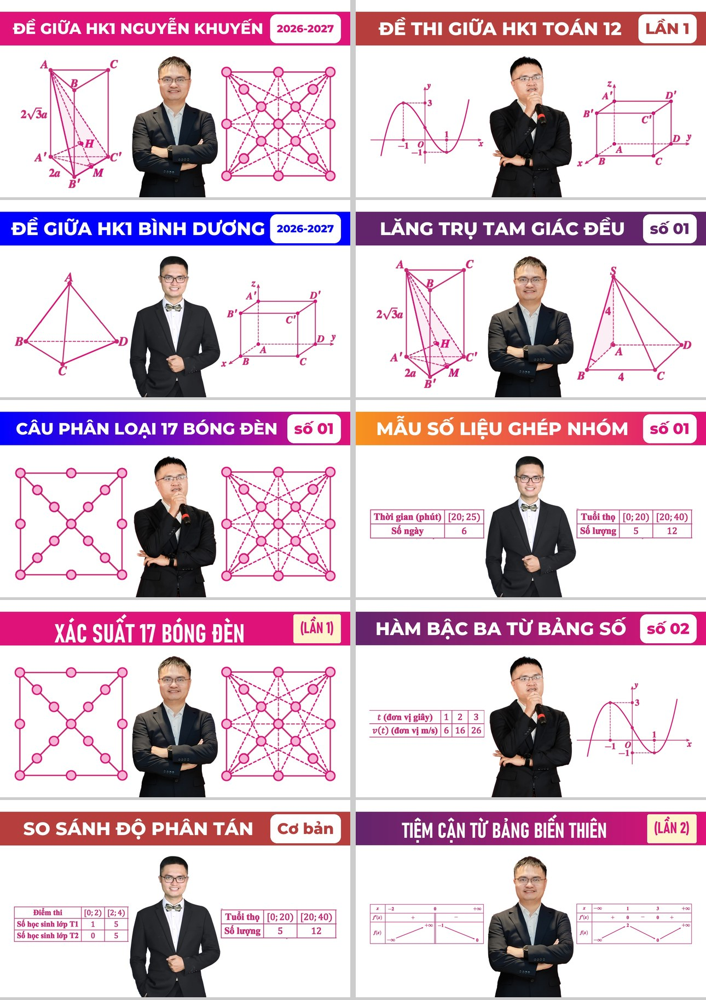

# Thumbnail bài giảng: code, không gen ảnh

Kết quả: ảnh 1280x720 nền trắng, thanh tiêu đề màu (y 43–165) có badge trắng bên phải, 2 hình cắt từ PDF hai bên tô hồng `#CD2674`, ảnh thầy tách nền ở giữa.



## Cần có

- Python 3.11+, `pymupdf`, `Pillow`.
- `fonts/Montserrat-ExtraBold.ttf`: tải Montserrat từ Google Fonts (OFL), chép file ExtraBold vào `fonts/`.
- Kiểu chữ hẹp dùng Bahnschrift có sẵn trên Windows (`C:/Windows/Fonts/bahnschrift.ttf`).
- Ảnh thầy PNG nền trong suốt bỏ vào `teacher/` (không có trong repo). `teacher/keep.json` ghi phần trên được giữ của từng ảnh: ảnh nửa người `1.0`, ảnh toàn thân cắt tới đùi khoảng `0.88` cho cỡ người đều nhau.

## Quy trình

### 1. Quét hình trong PDF

```bash
python figs.py de.pdf figs.jpg
```

In ra mỗi hình 1 dòng `{"page": p, "bbox": [x0, y0, x1, y1]}` và ghép `figs.jpg` có đánh số để chọn. Chỉ bắt được hình dạng ảnh. Bảng kẻ bằng nét vector thì tìm toạ độ bằng `page.search_for("chữ trong bảng")` rồi lấy khung các đường kẻ quanh đó.

Chọn hình:
- Hình gần vuông (khối chóp, lăng trụ, đồ thị, lưới điểm) đẹp nhất. Mỗi ô hình là 420x475.
- Bảng 2 dòng rất dẹt, thu vào ô thì chữ bé. Cắt còn cột tiêu đề + 1–2 cột số.
- Hình trong phần lời giải có nền hồng nhạt: thêm `"clear_bg": true`.

### 2. Viết config

```json
{"pdf": "de.pdf", "title": "ĐỀ GIỮA HK1 NGUYỄN KHUYẾN", "badge": "2026-2027", "bar": "pink",
 "figures": [{"page": 0, "bbox": [205, 306, 334, 412]}, {"page": 3, "bbox": [408, 513, 505, 610]}],
 "teacher": "teacher/thay-1.png", "out": "out/nguyen-khuyen.jpg"}
```

| Khóa | Giá trị |
|---|---|
| `bar` | `pink` `red` `blue` `purple`, mã hex, hoặc 2 màu chuyển `["#F7931E", "pink"]` |
| `badge` | `"2026-2027"`, `"số 01"`, `"LẦN 6"`, `"Cơ bản"`; bỏ trống thì tiêu đề căn giữa cả thanh |
| `font` | `wide` (Montserrat, mặc định) hoặc `condensed` (chữ hẹp cao, kiểu loạt "ĐỀ ÔN GIỮA HK1") |
| `badge_bg` | nền badge, kiểu chữ hẹp dùng vàng `#FFF4CC` |
| `figures[].clear_bg` | xoá nền hồng nhạt của hình |
| `figures[].bold` | độ dày nét (mặc định 3, `1` = giữ nguyên) |
| `figures[].pink` | `false` để giữ màu gốc |

Tiêu đề tự co cỡ để vừa ngang và vừa chiều cao thanh (tính cả dấu chồng như "Ề"). Badge ngắn (≤ 6 ký tự) chữ to gần bằng tiêu đề, badge dài như năm học chữ nhỏ. Xem 3 mẫu trong `configs/`.

### 3. Render và duyệt

```bash
python thumb.py configs/vi-du-mau-tron.json
```

Làm nhiều tấm: xoay vòng ảnh thầy (thay-1, thay-2, thay-3...), đổi màu thanh và kiểu badge giữa các tấm. Ghép sheet gửi user duyệt trước. Tự soát: dấu tiếng Việt không bị cắt, hình không chạm ảnh thầy, chữ trong bảng đọc được ở cỡ 640x360.

## Description YouTube

Mẫu đầy đủ: `examples/description-nguyen-khuyen.txt`. Thứ tự các khối:

1. Tiêu đề: `Chữa đề giữa kì 1 Toán 12 THPT <Trường> <Tỉnh> <Năm học> (mã <mã đề>) | Thầy Đỗ Văn Đức`.
2. 2 đoạn mở: tên đề, trường, ngày thi, mã đề; số câu, thời gian, cấu trúc 3 phần; đối tượng (2K9...) và kỳ thi hướng tới.
3. `🔥 NHỮNG CÂU ĐÁNG XEM NHẤT`: 4–6 gạch đầu dòng, mỗi dòng nêu câu và mấu chốt cách giải (số liệu cụ thể).
4. `⏱️ NỘI DUNG VIDEO`: `00:00` + danh sách phần. Chỉ ghi mốc giờ khi có video đã edit để lấy đúng giây.
5. `✅ ĐÁP ÁN NHANH (MÃ ĐỀ ...)`: Phần I liền 1 dòng, Phần II từng câu a/b/c/d Đúng/Sai, Phần III 1 dòng.
6. Link tải đề, link khoá học `https://tenschool.vn`, câu kêu gọi bình luận, hashtag, rồi dòng TAGS cách nhau dấu phẩy.

Đáp án lấy từ PDF lời giải, không tự giải lại.
